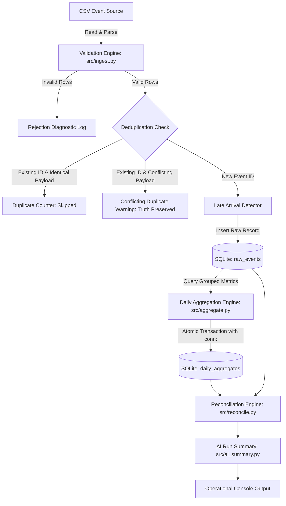

# Late-Arriving Event Pipeline Architecture (Bytespoke DAI-040)

## 1. Executive Summary & Problem Statement

In real-world data engineering pipelines, events often arrive out of chronological sequence due to network latencies, offline device syncing, or upstream batch delays. Naive processing based on arrival (`ingestion_time`) distorts historical reporting and creates inaccurate daily metrics.

This system guarantees:
1. **Event-Time Processing**: Events are assigned to business dates strictly according to `event_time`.
2. **Deduplication**: Primary keys on `event_id` prevent duplicate ingestion and double counting.
3. **Late-Arrival Correction**: Late events update historical aggregates atomically without corrupting concurrent or subsequent dates.
4. **Idempotency & Reconciliation**: Rerunning the pipeline produces identical metrics, verified by automated mathematical reconciliation.
5. **Isolated AI Interface**: Operational summaries support optional narrative AI enrichment while remaining 100% offline-capable with zero external dependencies.

---

## 2. System Architecture & Data Flow

---

## 3. Module Inventory & Responsibilities

| File Path | Component | Responsibility |
|:---|:---|:---|
| [`sql/schema.sql`](file:///Users/kunalsrivastav/Desktop/late-arriving-event-pipeline/sql/schema.sql) | DDL Schema | Defines `raw_events` table, `daily_aggregates` table, and `idx_raw_events_event_date` index. |
| [`src/init_db.py`](file:///Users/kunalsrivastav/Desktop/late-arriving-event-pipeline/src/init_db.py) | Schema Initializer | Reads and executes `schema.sql` idempotently against target SQLite databases. |
| [`src/ingest.py`](file:///Users/kunalsrivastav/Desktop/late-arriving-event-pipeline/src/ingest.py) | Ingestion Engine | Parses timestamps, validates types/ranges, enforces idempotency, protects against conflicting duplicate IDs, and detects late arrivals. |
| [`src/aggregate.py`](file:///Users/kunalsrivastav/Desktop/late-arriving-event-pipeline/src/aggregate.py) | Aggregation Engine | Groups raw records by `event_date`, computes order counts and revenue sums, and executes atomic upserts (`with conn:`). |
| [`src/reconcile.py`](file:///Users/kunalsrivastav/Desktop/late-arriving-event-pipeline/src/reconcile.py) | Reconciliation Engine | Independently re-computes metrics from `raw_events` and asserts equality with `daily_aggregates`. Exits with code 1 on failure. |
| [`src/ai_summary.py`](file:///Users/kunalsrivastav/Desktop/late-arriving-event-pipeline/src/ai_summary.py) | AI & Operational Summary | Generates authoritative deterministic metrics and provides an isolated AI interface for local/cloud LLMs with graceful fallback. |
| [`src/demo.py`](file:///Users/kunalsrivastav/Desktop/late-arriving-event-pipeline/src/demo.py) | Demonstration Script | Self-contained, isolated execution showing pre-correction baseline, late-event correction, numerical delta, and edge-case handling. |
| [`src/main.py`](file:///Users/kunalsrivastav/Desktop/late-arriving-event-pipeline/src/main.py) | Orchestrator & CLI | Stage-gated entry point enforcing prerequisite ordering (Init ➔ Ingest ➔ Aggregate ➔ Reconcile ➔ Summary). |

---

## 4. Data Model

### `raw_events`
Stores raw immutable event records.

| Column | Type | Constraints | Description |
|---|---|---|---|
| `event_id` | TEXT | PRIMARY KEY | Unique event identifier |
| `event_time` | TEXT | NOT NULL | ISO-8601 event occurrence timestamp |
| `ingestion_time` | TEXT | NOT NULL | ISO-8601 pipeline receipt timestamp |
| `amount` | REAL | NOT NULL CHECK (amount >= 0) | Order monetary amount |
| `event_date` | TEXT | NOT NULL | Derived YYYY-MM-DD date from `event_time` |

**Index**: `idx_raw_events_event_date` on `raw_events(event_date)` accelerates date-partitioned group queries.

### `daily_aggregates`
Stores historical and current daily metrics.

| Column | Type | Constraints | Description |
|---|---|---|---|
| `event_date` | TEXT | PRIMARY KEY | Unique business date |
| `total_orders` | INTEGER | NOT NULL DEFAULT 0 | Count of unique orders for date |
| `total_amount` | REAL | NOT NULL DEFAULT 0 | Sum of order amounts for date |
| `last_updated` | TEXT | NOT NULL | Timestamp of last aggregate recalculation |

---

## 5. Event-Time vs. Ingestion-Time Semantics

- **Event Time (`event_time`)**: The business timestamp recording when the order occurred. The business date (`event_date`) is derived exclusively from this attribute (`event_time.date()`). All aggregates, metrics, and reporting group records strictly by `event_date`.
- **Ingestion Time (`ingestion_time`)**: The operational timestamp recording when the pipeline gateway received the payload. It is retained solely for auditability, latency tracking, SLA measurement, and arrival lag calculation. It is **never** used to group business revenue.

---

## 6. Key Pipeline Strategies

### Late-Event Handling Strategy
- Late arrivals are identified when `event_date < ingestion_date`, when `event_time` is prior to the maximum `event_time` recorded in `raw_events`, or when lag exceeds a configured watermark (`time_diff > late_threshold_seconds`).
- Instead of appending late totals to the current date, the pipeline routes the record to `raw_events` using `event_date`.
- Aggregations recalculate totals for the affected historical `event_date` and execute an atomic `UPSERT` (`ON CONFLICT(event_date) DO UPDATE`) on `daily_aggregates`.
- Subsequent or concurrent dates remain completely unaffected.

### Deduplication & Idempotency Strategy
- Duplicate `event_id`s in the input stream are ignored if payloads match.
- If a duplicate `event_id` contains a conflicting payload (e.g. modified amount), it is logged as a conflicting duplicate and preserved without overwriting existing ground truth.
- Aggregates are derived directly from `raw_events` via `GROUP BY event_date`, ensuring repeated pipeline runs produce identical results.

---

## 7. Verification & Reconciliation

The reconciliation check independently queries `raw_events` and compares the computed metrics against `daily_aggregates`. Any variance in order counts or totals triggers a reconciliation warning and non-zero exit code.
