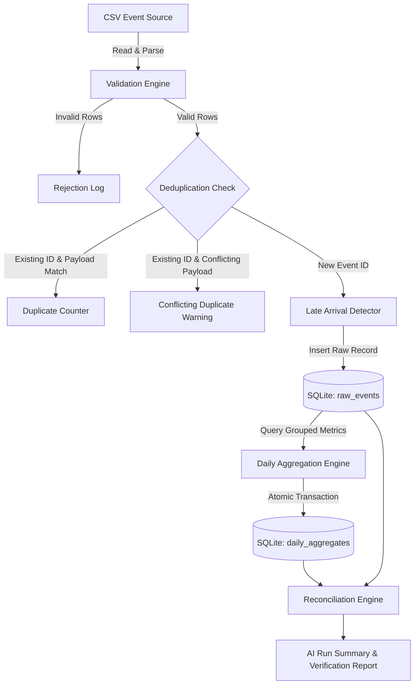

# Late-Arriving Event Pipeline Architecture

## 1. Executive Summary & Problem Statement

In real-world data engineering pipelines, events often arrive out of chronological sequence due to network latencies, offline device syncing, or upstream batch delays. Naive processing based on arrival (`ingestion_time`) distorts historical reporting and creates inaccurate daily metrics.

This system guarantees:
1. **Event-Time Processing**: Events are assigned to business dates strictly according to `event_time`.
2. **Deduplication**: Primary keys on `event_id` prevent duplicate ingestion and double counting.
3. **Late-Arrival Correction**: Late events update historical aggregates atomically without corrupting state.
4. **Idempotency & Reconciliation**: Rerunning the pipeline produces identical metrics, verified by automated reconciliation.

---

## 2. System Architecture & Data Flow

---

## 3. Data Model

### `raw_events`
Stores raw immutable event records.

| Column | Type | Constraints | Description |
|---|---|---|---|
| `event_id` | TEXT | PRIMARY KEY | Unique event identifier |
| `event_time` | TEXT | NOT NULL | ISO-8601 event occurrence timestamp |
| `ingestion_time` | TEXT | NOT NULL | ISO-8601 pipeline receipt timestamp |
| `amount` | REAL | NOT NULL CHECK (amount >= 0) | Order monetary amount |
| `event_date` | TEXT | NOT NULL | Derived YYYY-MM-DD date from `event_time` |

### `daily_aggregates`
Stores historical and current daily metrics.

| Column | Type | Constraints | Description |
|---|---|---|---|
| `event_date` | TEXT | PRIMARY KEY | Unique business date |
| `total_orders` | INTEGER | NOT NULL DEFAULT 0 | Count of unique orders for date |
| `total_amount` | REAL | NOT NULL DEFAULT 0 | Sum of order amounts for date |
| `last_updated` | TEXT | NOT NULL | Timestamp of last aggregate recalculation |

---

## 4. Key Pipeline Strategies

### Late-Event Handling Strategy
- Late arrivals are identified when `event_date < ingestion_date` or when `event_time` is prior to the maximum `event_time` recorded in `raw_events`.
- Instead of appending late totals to the current date, the pipeline routes the record to `raw_events` using `event_date`.
- Aggregations recalculate totals for the affected historical `event_date` and execute an `UPSERT` (SQL `ON CONFLICT DO UPDATE`) on `daily_aggregates`.

### Deduplication & Idempotency
- Duplicate `event_id`s in the input stream are ignored if payloads match.
- If a duplicate `event_id` contains a conflicting payload (e.g., modified amount), it is logged as a conflicting duplicate and preserved without overwriting existing ground truth.
- Aggregates are derived directly from `raw_events` via `GROUP BY event_date`, ensuring repeated pipeline runs produce identical results.

---

## 5. Verification & Reconciliation

The reconciliation check independently queries `raw_events` and compares the computed metrics against `daily_aggregates`. Any variance in order counts or totals triggers a reconciliation warning.